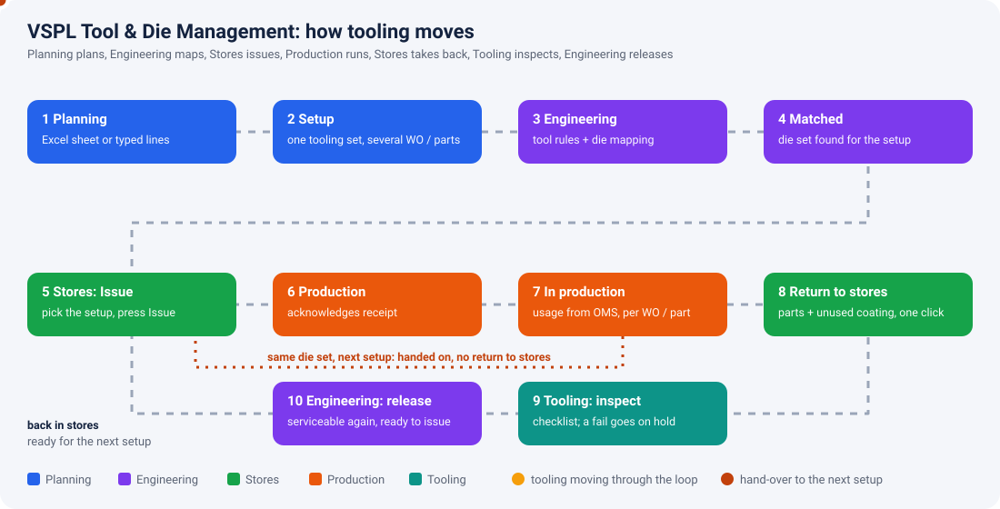

# VSPL Tool and Die Management

Built to `VSPL_Tool_and_Die_Management_Developer_Specification` in phases.
**Status: all 5 phases built** (Phase 1: inventory, identity, locations, documents, login and roles. Phase 2: assembly
definitions, physical builds, ME mapping stand-in. Phase 3: WO readiness check, issue/return, QR labels and scanning.
Phase 4: consumable batches, inspection checklists, repair, disposition, scrap approval. Phase 5: OMS usage and tonnage,
stock counts, reconciliation, reports, backup/restore and the A01-A16 acceptance tests). `archive_v1/` holds the first prototype (fixed 4-slot
assemblies, issue/return); it is not loaded and is reference only.

## Workflow

<p align="center"></p>

| Step | Who | What happens |
|---|---|---|
| 1-2 | Planning | Imports the planning sheet (a SETUP column groups WO / part lines) or types a setup in. One setup is one tooling set running one or more WOs and parts. |
| 3-4 | Engineering | Keeps the tool mapping rules (part / description / family to assembly) and the die mapping (each die with its own pattern and flanges). A setup shows its die set and bins once matched. |
| 5 | Stores | **Issue**: choose the setup, everything else is pre-filled, press Issue. A die set already in production can be **handed on** to the next setup with no return. |
| 6-7 | Production | Acknowledges receipt, then runs. OMS usage (cycles, castings, tonnes) is posted per WO and part. |
| 8 | Stores | **Return**: pick what is back, type only the unused coating, one click. Parts go to their home bin. |
| 9-10 | Tooling, Engineering | Returned parts are inspected against the checklist (a fail goes on hold); Engineering releases them to serviceable. |

| Role | Main screens |
|---|---|
| Planning | Setups (import, add lines) |
| Engineering | Die mapping, tool rules, designs, assemblies, ME mapping, release |
| Stores | Issue, Returns, Batches, Stock counts |
| Production | Acknowledge receipt, Readiness |
| Tooling | Inspection, Repair and hold |
| Admin | Everything, including users |

## Setup (PowerShell, Python 3.11)
```powershell
cd backend
py -3.11 -m venv .venv
.\.venv\Scripts\Activate.ps1
pip install -r requirements.txt
```

## First run
There is **no default account**. Either create your first administrator:
```powershell
python -m app.create_admin
```
or load fake test data (random passwords are written to `backend\seed_credentials.txt`; delete it with the test database):
```powershell
python -m app.seed --reset
```
Seeded users: admin, engineer, stores, production, tooling, scrap, manager (one role each) and `oms`, the INTEGRATION service account for the OMS usage feed.

## Run
```powershell
# window 1
cd backend
.\.venv\Scripts\python -m uvicorn app.main:app --reload --port 8000
# window 2
cd frontend
npm install
npm run dev
```
Open http://localhost:5173. API docs: http://localhost:8000/docs. Tests: `cd backend; python -m pytest -q`.
To point the UI at another API: `$env:VITE_API_URL="http://host:8000"` before `npm run dev`.

## How it works
- **Identity:** every physical item has an immutable internal ID (`TI-000123`, the QR target). The existing tooling
  number stays visible and searchable; it may repeat, so each item also has a unique display ID.
  IDs are normalised (trim, uppercase, `b32-01` -> `B32-1`).
- **Condition, custody and location are never typed in.** They come from the item's latest effective ledger entry.
  Moving an item never changes its condition (a hold survives a move).
- **Ledger is append-only** (database triggers). Corrections are REVERSAL entries. Every API call gets one `event_id`;
  reversing any row reverses every row of that event, or nothing. Two writers acting on the same stale state collide
  instead of both succeeding.
- **Roles** (server-side, bearer token): ADMIN, ENGINEERING, STORES, PRODUCTION, TOOLING, SCRAP_APPROVER, MANAGER.
  A user may hold several. Administrators configure masters and users but cannot approve designs/documents,
  release a hold, or scrap. Passwords: scrypt; tokens: HMAC-signed, 12 h; 5 failed sign-ins lock a user for 5 minutes
  (per server process). The signing key is `backend\secret.key` (created on first run; keep it private) or set `DIE_SECRET_KEY`.
- **Files** (documents, photos) live in `backend\storage\`, are type/size/content checked, and are only served to signed-in users.
- **Audit:** every master-data, approval, condition, user and reversal action records user, time, before/after and reason.
- **Import:** `templates\items_template.xlsx` (also downloadable in the UI). Preview first; any error rejects the whole
  file. Duplicate legacy numbers are held in a review queue, never overwritten. Blank opening usage = unknown, not zero.

## Assemblies (Phase 2)
- **Definition vs build.** A *definition* is a versioned list of element designs and quantities (any number of lines,
  with approved substitutes and optional accepted revisions; blank = current approved revision only). Engineering approves
  it; approved revisions are immutable and a new approval supersedes the previous one. A *build* records the exact item IDs
  fitted against one approved revision. A definition has many builds.
- **Builds.** Fit by scanning. Rejected: wrong design/revision, not serviceable, retired, not in stores custody (issued),
  already fitted elsewhere, or no free position. To use a part from another stored build, remove it there first. A fitted
  item takes ASSEMBLY_AREA custody and the build's location (so it is never shown as available in its bin); moving an intact
  build moves all components together. Any component change sends a verified build back to ASSEMBLING; it must be verified
  again (named assembler and verifier recorded). Dismantling closes the build and each component is scanned to a confirmed
  destination; membership history is kept. The database allows only one active membership per item.
- **Matching.** Verification and fitting use distinct-item matching, so one physical item can never satisfy two lines or two
  units of a line. The same matcher will drive the WO readiness check in Phase 3.
- **ME mapping** (`/mappings`) is a *reference copy* entered by Engineering until the ME integration contract is agreed
  (source MANUAL). Only options with an approved assembly revision and tooling READY are selectable; others show why not.
- FIT/REMOVE ledger rows cannot be reversed (membership has its own history): correct by removing/fitting explicitly.

## Readiness, issue and return (Phase 3)
- **Readiness** (`POST /readiness/checks`, screen *Readiness*) is the WO-release gate that OMS will call; until OMS is connected the screen
  stands in for it. It answers READY / NOT READY / UNABLE TO VERIFY for the selected ME option, using distinct-item matching (one
  item never satisfies two positions). Serviceable items that are stored, fitted in another build or issued all count; those that are
  issued or fitted show as **custody warnings** and nothing is reserved. Missing, held, awaiting-inspection, under-repair or scrapped
  items do not count and the shortage names them. Draft/obsolete assemblies and tooling marked to be developed are NOT READY. An
  unmapped operation or no selected option is UNABLE TO VERIFY (never ready, no bypass). If the selected option fails but another
  passes, the alternative is shown, never selected for you. Every check is stored (time, revisions, reason codes, candidate items
  as evidence). If a later hold, retirement, assembly/design revision or mapping change affects the latest READY check of an open WO, it is
  **flagged for recheck** (`GET /readiness/recheck`); nothing is cancelled. OMS closes a WO with `POST /readiness/wo/{wo}/close`.
- **Issue** (Stores): scan a build, or any part of it, to expand its verified component list; the issue must confirm exactly that list.
  The server re-validates the approved configuration (mapping, revision) and every item's condition and custody, then issues all
  components together or none. Items become PENDING_HANDOVER (not free stock); **Production acknowledges** under their own account
  -> PRODUCTION. Two competing issues of the same parts: only one succeeds.
- **Return** (Stores): record what actually came back; partial returns are supported and the rest stays outstanding. Returned items become
  AWAITING_INSPECTION (HOLD when damaged, with the damage described) and stay unavailable until cleared. An intact build can be returned
  without dismantling, or dismantled afterwards.
- Pending/in-production/returned state of each issue line is **derived from the ledger**, so reversing an ISSUE, ACKNOWLEDGE or RETURN
  event works like any other (each partial return reverses on its own). While a build is issued its components cannot be removed or moved.
- **QR labels** (`qrcode` library, drawn as SVG): items carry their system ID, builds `BLD-000012`, locations `LOC:P1/A1/R1/S1/B1`. Printing a
  label is audited and a reprint is byte-identical, so it never creates a new identity. **Scanning** accepts a keyboard-style scanner,
  typed codes, or the phone/tablet camera (QR support in Chrome/Edge; camera needs https or localhost).
  One resolver (`GET /scan`) understands item, build and location codes.

## Consumables, inspection, repair and approvals (Phase 4)
- **Consumable batches.** A batch is counted stock, not tracked piece by piece. Its balances (usable, held, issued-not-settled, consumed) are the
  SUM of an append-only batch ledger, so they can never be edited, and a database trigger refuses any row that would make a balance negative.
  Hold/release, authorised adjustments (Engineering, always with a reason), moves, expiry and supplier lot are supported; a batch also has a QR label.
- **Issue with consumables.** Each consumable line of the assembly carries a required quantity and its **basis** (ME requirement or authorised entry).
  The issue needs batch picks totalling it (a different quantity needs a documented reason); insufficient, expired or held batches are rejected;
  stock and part custody commit in ONE transaction. **Return**: record the verified UNUSED quantity; the rest is recorded as consumed, exactly once.
  Reversing an issue or return event undoes both ledgers together. Readiness only *warns* about low/absent consumable stock; it never reserves.
- **Inspection checklists** are data: one per tooling category plus design-specific additions, versioned and approved by Engineering (starting content:
  completeness/ID, cleaning, cracks, wear, damage, critical dimensions, fasteners, coating, storage readiness; limits are Engineering's, not universal).
  Checks can be pass/fail/n.a. (reason needed), numeric (judged against limits by the system), or text, with photo evidence never/on fail/always.
  An inspection keeps the checklist versions it used, so later changes never rewrite history. Each returned item is inspected on its own, so one failed
  element neither clears nor condemns the others. A failed *required* check forces a HOLD.
- **Release.** A passing inspection releases nothing. An item becomes SERVICEABLE only through **Engineering's release after a passing inspection**
  (the ledger refuses anything else, and a hold never jumps straight to serviceable: it goes for further inspection first).
- **Disposition.** For a held item Tooling decides REPAIR, FURTHER INSPECTION or PROPOSE SCRAP, recording findings and who is responsible. Repair
  ends in re-inspection (never straight to serviceable). Scrap stays on HOLD until the designated **scrap approver** decides. Reworking an item to a new
  approved design revision (during repair) is approved by Engineering, keeps identity and history, and flags open WOs for recheck.
- Rows written by these workflows (inspection hold, repair, scrap...) are corrected through the workflow, not by hand-reversal.

## Usage, stock counts, reports, backup (Phase 5)
- **OMS usage feed** (`POST /integration/usage`, role INTEGRATION; ENGINEERING can submit by hand as a stand-in). Each message is identified by
  `(source_event_id, version)`: a replay changes nothing, a higher version supersedes the earlier one (adjusts once), a late older version is ignored,
  the same id and version with different content is refused, `cancelled: true` withdraws an event. **Cycles and castings are kept separate**;
  tonnage = castings x pouring weight / 1000, using the weight and ME revision in force when the event was posted, so a later weight change never rewrites
  history. Unknown weight leaves tonnage *unknown*, never zero. An event is tied to the issue of its build at the production time; if it cannot be
  (no build, unknown build, build not issued then, several issues) it waits in the **exception queue** with a reason, retry count and last attempt, and is
  never guessed. Engineering/Production retry or resolve it; the original message is kept, the correction is stored separately. Foundry output counts
  assembly events only, so component exposure is never double counted.
- **Component replacement in production** (Issue page): the replaced part stays outstanding on the issue, the new part is fitted and issued in one
  event, and usage before/after the change goes to the respective items.
- **Stock counts**: scan what is physically in a location; the report shows expected / found / unexpected / missing and batch variances. A count only
  observes. Engineering then applies adjustments one by one with a reason (mark missing, recover, record here, correct a batch); each is re-checked against the
  current state so it cannot be applied twice. A **missing** item cannot be fitted, issued or moved and never passes a readiness check.
- **Documents in force** are snapshotted on each issue (assembly, design and item documents), so an issue keeps the revision it used while newer approved
  revisions apply to new work only.
- **Reports** (Reports page, each with Excel export): inventory by location/condition, assembly readiness, custody by WO, missing and overdue,
  repairs, cycles/tonnage by item, 5S mismatches, batch stock, audit trail. Refused actions are audited as `DENIED`.
- **Concurrency**: every changing request takes the database write lock before it reads, so two simultaneous issues of the same item are strictly
  one after the other and the second is refused (acceptance test A07 runs real parallel requests).
- **Backup and restore** (records and attachments, one zip with a SHA-256 manifest):
```powershell
python -m app.backup create                                        # online backup into the backups folder; safe while the system is in use
python -m app.backup verify backups/die_mgmt_backup_<time>.zip     # checks every file against its checksum
python -m app.backup restore backups/die_mgmt_backup_<time>.zip D:/restore   # refuses to overwrite an existing database (add --overwrite)
```
- Acceptance tests A01-A16 are in `backend/tests/test_acceptance.py`; A16 imports 4,000 items, builds 1,000 assemblies, searches, scans and restores a
  backup (about 40 s).
- Assumptions to confirm: stock adjustments are Engineering only; the home-location mismatch reason is reported (5S report) but not enforced; OMS times
  are read as UTC; hand-reversal is not offered for fit/remove, workflow and count rows (use the workflow).

## Planned setups (Planning)
- **Planning enters setups** (role `planning`) on the Setups page: import the planning sheet (Excel; the header can be on any of the first rows, other
  columns and `#REF!` cells are ignored) or type a line. Columns used: WO NO, PART ID (the internal ID), TOOL DESCRIPTION, FAMILY, optional INTERNAL GRADE,
  FG QTY, RCD QTY, WEIGHT, INTERNAL ID / SL NO. One setup per WO NO + PART ID; a line already planned is skipped, never overwritten; a bad number blocks the
  whole commit. A template can be downloaded from the page.
- **Matching to tooling** is Engineering's rule table (part ID and/or tool description and/or family -> tool assembly; the most specific rule wins; two equally
  specific rules that disagree show as AMBIGUOUS and nothing is chosen). Matching is live, so a new rule applies to existing setups at once. A matched setup
  shows the die / pattern numbers and bins of the built assemblies and of the serviceable parts available.
- **Issuing is always for a setup** (mandatory): Stores picks one of the planned setups matched to the scanned build. The WO is taken from the setup, a setup can
  be out on only one issue at a time, and the issue, returns and lists show the setup.
- After upgrading from an earlier build run `python -m app.seed --reset` (new tables and role); there is no migration yet.

## Quick issue and quick return
- **Issue:** choose the setup; everything else is pre-filled. The die set is picked for you (the first free one, else the first that can be handed on), all
  WO / part lines are ticked with their operation, and the coating batch and quantity are chosen. You see the parts with their IDs and bins and press **Issue**.
  Lines, operations, coating and "scan a different set" are behind "Change…". A set handed on from another setup asks only for the coating left over.
- **Return:** on the Returns page pick what is out from the dropdown, or scan / type a die set, a part, the WO or the setup. The issue opens with a
  **Return to stores** panel: every part is ticked and goes back to its **home bin** (override behind "Put them somewhere else…"), "report damage" is one click,
  and the only thing typed is the unused coating (0 if none). One button returns the parts and settles the coating; parts then wait for inspection.

## One setup, several WOs and parts
- A **setup** is one tooling set mounted once; it runs one or more **WO / part lines**. In Planning's sheet a **SETUP** column groups the rows (rows with the
  same setup belong together; a row with no setup is a setup of its own; new rows naming an existing setup are added to it). Lines can also be typed in
  ("Add a setup by hand" has "+ Another WO / part") or added later to a setup that is not out.
- A setup is matched to tooling only when **every line** points to the same assembly; otherwise it is shown as unmatched or ambiguous, naming the line.
- On the Issue page, choosing a setup shows "This setup covers N WO and M parts" with a tickbox and an operation dropdown per line (the only / ME-selected
  operation is pre-picked). **One issue covers the ticked lines**: it lists every WO and part, usage from OMS goes to the right WO with that part's pouring
  weight, and the issue is found by any of its WOs. A WO that is not in the setup is never attributed (it waits for reconciliation).

## Issuing from the setup, and handing a die set on
- The **Issue** page starts from the **setup**: choose it from a dropdown (planned, matched to tooling, not issued), the operation comes from the ME
  mapping for that part, and the **die set** is another dropdown listing the built assemblies with their die, pattern, flanges and bin.
- **Reuse without a return:** a set that is still in production for an earlier setup is listed as "in production for SET-… · can be handed over". Choosing it
  hands the set on to the new setup in one step: the old issue closes (parts show HANDED ON), a new issue opens for the new setup and Production
  acknowledges it again. The old setup's coating is settled (enter the unused quantity) and the new setup's coating is issued in the same step. The parts never
  go back to stores or through inspection. Usage before the hand-over stays with the old setup, usage after goes to the new one.
  Only Stores can do it (`POST /issues/{id}/hand-over`); every part must be in production and acknowledged.

## Inventory by type and die mapping
- The Inventory page has tabs for **Die, Pattern, Top flange and Bottom flange** (plus All), each showing ID, description, condition, custody and bin.
  The Die tab also shows each die's pattern, top flange and bottom flange; the other tabs show the die a part is used with.
- **Die mapping** (Engineering): each physical die has one fixed pattern, top flange and bottom flange (pattern and flanges may be left empty). A part belongs
  to only one die; saving a die again replaces its set and frees the old parts. It is a reference for finding the right parts and does not reserve or move them.
  An item's page shows the set it belongs to.

## Layout
`backend/app/models.py` tables, `item_state` view, append-only triggers · `services/` business logic
(`ledger.py` state/moves/condition/reversal, `items.py`, `designs.py`, `assemblies.py`, `builds.py`, `mappings.py`,
`matching.py`, `readiness.py`, `recheck.py`, `issues.py`, `usage.py`, `counts.py`, `reports.py`, `batches.py`, `inspections.py`, `dispositions.py`, `labels.py`, `scan.py`, `documents.py`, `imports.py`, `config.py`, `auth.py`, `permissions.py`, `audit.py`; `backup.py` is the backup CLI) · `routers/` thin HTTP layer · `tests/` pytest · `frontend/` React + Vite.
